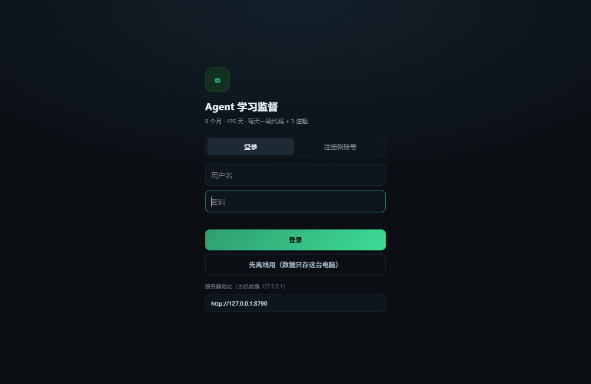
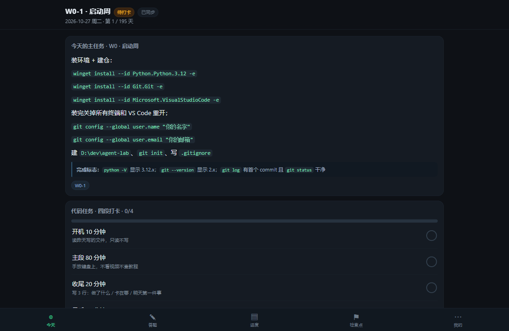
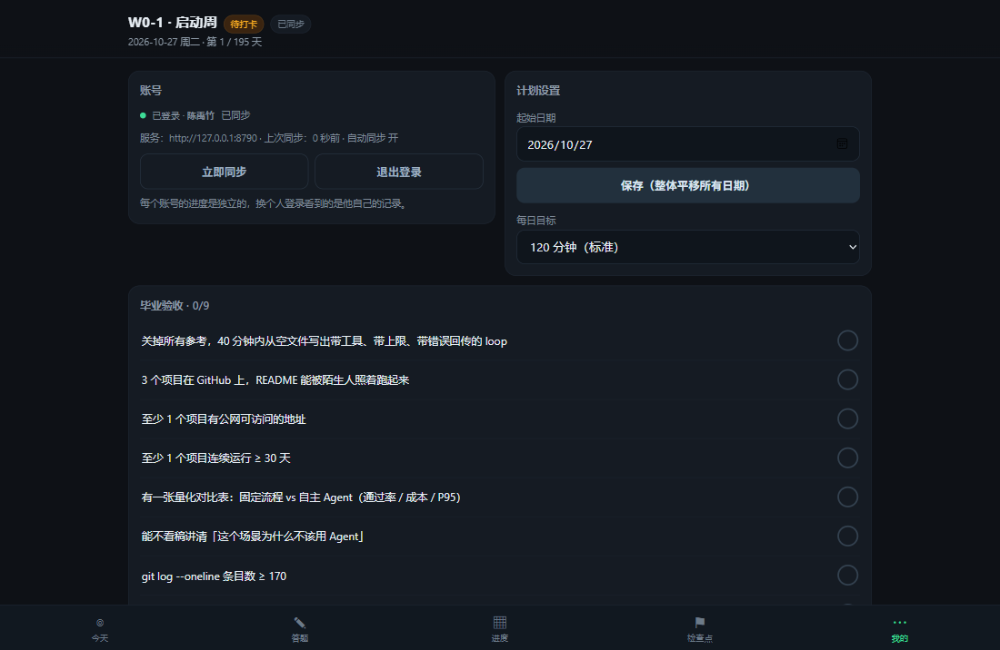
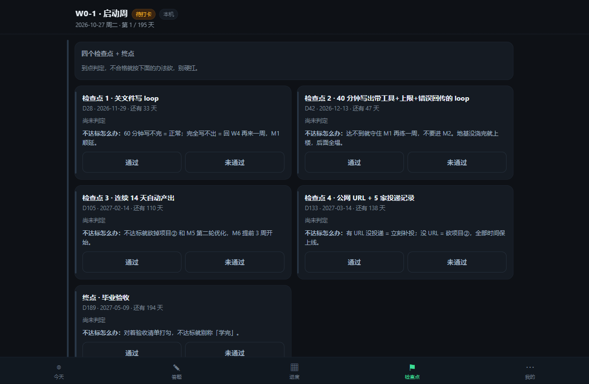

# 学习监督 · 电脑端（账号登录版）

把《AI-Agent 学习计划 v2（8 个月版）》变成每天会催你的工具：**电脑浏览器打开 → 登录 → 今天该干什么、该敲哪段代码、该答哪 3 道题，一目了然。**

现在有账号体系：你的账号是 **陈禹竹**，密码 **230319**；别人可以自己注册账号，各自的数据完全独立。

---

## 零、它现在是自启动的

已经在 Windows 计划任务里注册了 **AgentStudyWeb**，行为是：

| 什么时候 | 会发生什么 |
|---|---|
| 你登录 Windows 15 秒后 | 自动在后台起服务（`pythonw`，**没有黑窗口**） |
| 每分钟 | 检查一次。服务挂了就自动拉起（实测 kill 掉后 20 秒内恢复） |
| 你双击网页 | 直接打开 http://127.0.0.1:8790 ，不用先开命令行 |

所以现在的用法就一句：**开机 → 打开浏览器 → 用。**

日志在 `server\server.log`（服务正常时不写噪音，只记启动和请求）。

**想撤掉自启**：双击 `卸载开机自启.bat`，或手动
```bat
schtasks /Delete /TN AgentStudyWeb /F
```
数据不受影响，仍在 `server\data.db`；之后要手动跑就双击 `启动服务.bat`。

> 注意：这是「登录后启动」，不是纯开机启动（锁屏状态下起服务没意义）。如果你希望电脑一上电就跑、不登录也能访问，那是另一种配法，说一声我改。

---

## 一、30 秒开始

### 1. 服务已经在跑（不用管）

只有一种情况需要手动：你把任务卸载了，或者想临时跑一份。这时双击 `启动服务.bat`。

手动启动时如果提示「端口已被占用」，说明后台那个正在跑，直接开网页就行。

### 2. 打开网页

双击 `打开学习监督.url`（可以复制到桌面），或浏览器输入 **http://127.0.0.1:8790**

### 3. 登录

- 用户名：`陈禹竹`
- 密码：`230319`

第一次登录会自动建号并把进度存在 `server\data.db`。

> 想给别人用：让对方点「注册新账号」，自己填用户名和密码（≥6 位），登录后就是**他自己的独立空间**，看不到你的记录。



---

## 二、每天怎么用

| 位置 | 你做什么 |
|---|---|
| **今天** | 看当天主任务（第几天、哪个阶段、具体命令）+ 完成标志；敲完代码回来勾四段打卡、填 commit 哈希、记卡点 |
| **答题** | 每天 3 道选择题，按你当天所处阶段出题，答完立刻给解释 |
| **进度** | 195 天热力图、连续天数、累计小时、各阶段完成率 |
| **检查点** | D28 / D42 / D105 / D133 四次硬验收，未通过会告诉你该砍什么 |
| **我的** | 账号、计划设置、毕业验收清单、导出/导入、每日提醒 |





**判定规则**

- 「今日完成」= 四段打卡全勾（读 10 / 主段 80 / 收尾 20 / commit 10）。
- 连续天数从今天往前数，断一天归零。
- 答题不影响「完成」，但错的题会告诉你为什么错，检查点那天要能答得出来。

---

## 三、账号系统

| 项 | 说明 |
|---|---|
| 预置账号 | `陈禹竹` / `230319`（首次启动自动创建，密码已用 PBKDF2-SHA256 120000 轮哈希存库） |
| 注册 | 用户名 2-20 位，可用中文、字母、数字、`_ - · .`；密码 ≥ 6 位 |
| 数据隔离 | 每个账号在 `users` / `state` 两张表里有独立行，登录只返回自己的数据 |
| 改密码 | 接口已有：`POST /api/password {old,new}`（界面上暂未放按钮） |
| 退出登录 | 「我的 → 退出登录」，需点两次确认；退出会清空本机缓存，重新登录从服务端拉回 |
| 离线 | 登录页有「先离线用」，数据只存这台电脑，之后可再登录同步 |

验证过的行为：重复注册返回 409；密码错返回 401；两个账号互相看不到对方记录（已用脚本 `build/test-auth.ps1` 跑通）。

---

## 四、目录

```
ai-agent-plan-v2\
├─ AI-Agent-学习计划-v2-8个月版.md   计划原文（执行主表）
├─ 启动服务.bat                      双击即跑
├─ server\
│  ├─ server.py                      服务（单文件，仅标准库）
│  ├─ web\index.html                 网页（和 APK 内置同一份）
│  └─ data.db                        账号 + 进度（SQLite，备份就复制这个文件）
├─ web\index.html                    构建产物
├─ android\  build\  dist\           安卓工程 / 构建脚本 / APK（现在用不到，保留）
└─ docs\                             界面截图
```

重新构建：

```powershell
powershell -NoProfile -ExecutionPolicy Bypass -File build\build-apk.ps1
```
（会同时刷新 `web\index.html`、`server\web\index.html`、`dist\AgentStudy-2.0.apk`）

---

## 五、微信登录（可选，需要你先备料）

当前是账号密码登录。微信扫码登录的接口已经写好，配三个环境变量就启用：

```powershell
$env:WECHAT_APP_ID="wx................"
$env:WECHAT_SECRET="................................"
$env:PUBLIC_URL="https://你的已备案域名"
python server.py
```

前置条件：

| 需要 | 说明 |
|---|---|
| 微信开放平台「移动应用」 | open.weixin.qq.com 注册 → 提交包名 `com.ygbuddy.agentstudy` + 签名 MD5 `988203aa5e62584d6eab7991c548176a` → 审核 + 300 元认证 |
| 公网 https 域名 | 微信回调必须是域名，不能用 IP，国内还需备案 |

代码位置：`server/server.py` 的 `/api/wechat/url` 与 `_wechat_callback`；登录页会自动探测，配置后出现「微信扫码登录」按钮。

---

## 六、已知限制

1. **本机版只能本机/局域网访问**。要 7×24 公网可访问（手机、别人电脑都能开）：

   - 看 **[DEPLOY.md](DEPLOY.md)**：部署到 Render 免费版 + 数据存你的 GitHub Gist
   - 代码已经准备好了（`render.yaml` / `Procfile` / `runtime.txt` 都在）
   - 本地仓库已 `git init` 并 `git add`（敏感文件已排除），只差你在 GitHub 建空仓库，然后双击 **`部署到GitHub.bat`**
2. **密码重置没有界面**。忘了密码可以改库：把 `users.pass_hash` 置空，重启服务会自动按预置密码重建（只对 `陈禹竹` 生效）。
3. **每日提醒只对安卓 App 有效**，网页版没有系统通知。
4. 数据不上传任何第三方，全部在你自己的 `server\data.db`。
